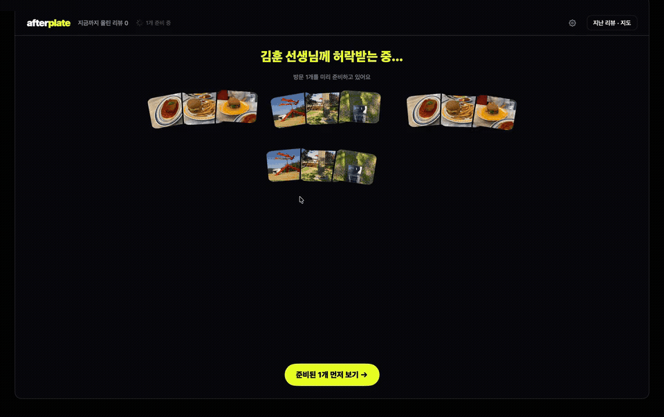
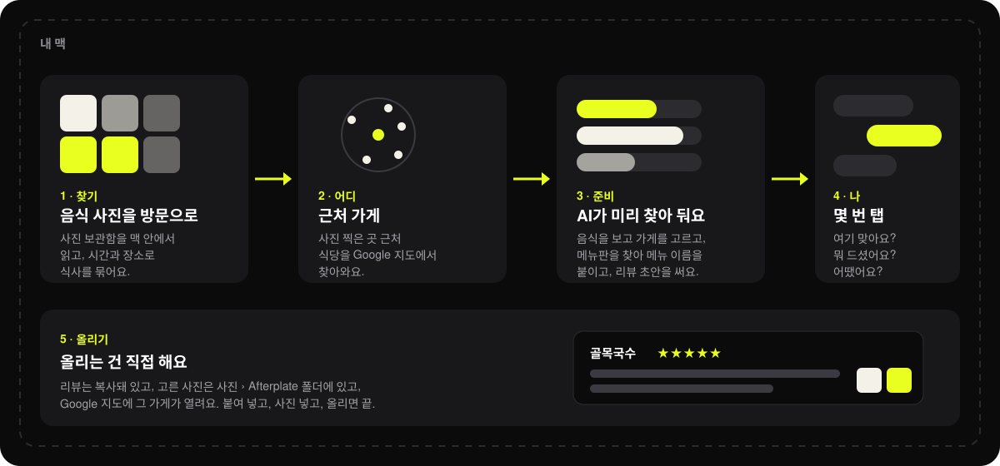
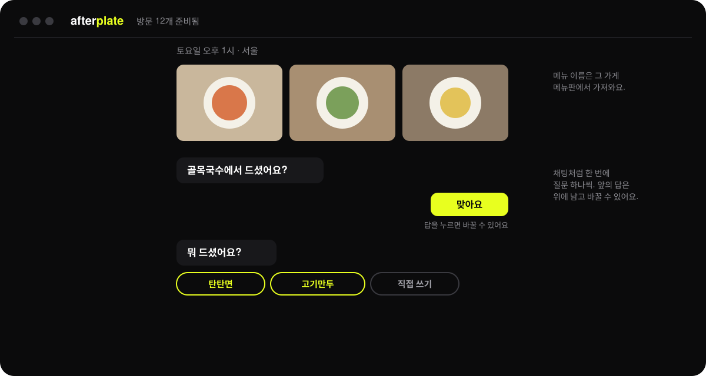
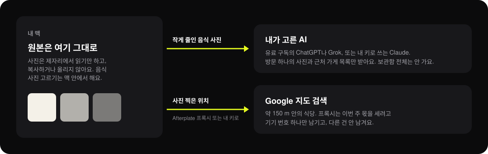

<p align="center"><a href="README.md">English</a> · <b>한국어</b></p>

<p align="center"></p>

<h1 align="center">Afterplate</h1>

<p align="center">찍어만 둔 음식 사진, 이제 리뷰로.<br>사진 보관함 속 식사를 몇 번 탭으로 Google 지도 리뷰로 만들어 주는 맥 앱이에요.</p>

<p align="center"></p>

---

## 어떻게 돌아가나요



1. **찾기.** 맥의 사진 보관함을 읽어요. 맥 안의 모델(Apple Vision, Google SigLIP)이 식사 사진을 골라요. 비슷한 시간과 장소에서 찍은 사진은 방문 하나로 묶여요.
2. **어디.** 사진 찍은 곳에서 약 150 m 안의 식당을 Google 지도에서 찾아와요.
3. **준비.** 고른 AI가 사진과 가게 목록을 봐요. 상에 놓인 음식으로 가게를 고르고, 웹에서 그 가게의 진짜 메뉴판을 찾아 음식마다 메뉴 이름을 붙이고, 리뷰 초안을 써요. 방문 몇 개를 미리 준비해 둬서, 차례가 오면 바로 볼 수 있어요.
4. **나.** 채팅처럼 한 번에 질문 하나씩이에요. 여기 맞아요? 뭐 드셨어요? 어땠어요? 추측을 답처럼 보여 주지 않아요. 확실하지 않으면 물어봐요.
5. **올리기.** 올리는 건 직접 해요. 리뷰는 복사돼 있고, 남긴 사진은 `사진 › Afterplate` 폴더에 있고, Google 지도에 그 가게가 열려요.

## 대화



- 방문에서 사진을 끌어내면 리뷰에서 빠져요. 사진을 누르면 크게 보여요.
- 앞에서 한 답을 누르면 바꿀 수 있어요.
- "나중에"는 방문을 미뤄 둬요. "밥 아니에요"는 아예 빼요.

## 무엇이 맥 밖으로 나가나요



- **원본**은 복사하지도, 올리지도 않아요.
- **방문 사진을 작게 줄인 것**은 고른 AI에게 가요. 음식을 봐야 하니까요.
- **사진 찍은 위치**는 Google 지도 검색에 가요. 기본으로는 Afterplate의 Google 키를 가진 작은 서버(프록시)를 거쳐요. 프록시는 그 맥의 이번 주 몫을 세려고 기기 번호 하나만 남겨요. [내 Google 지도 키](docs/google-maps-key.ko.md)를 넣으면 Google로 바로 가요.

## AI 고르기

| AI | 필요한 것 | 비용 |
|---|---|---|
| ChatGPT | ChatGPT Plus 이상 | 구독 사용량에서 써요. 추가 요금 없음 |
| Grok | SuperGrok 또는 X Premium+ | 구독 사용량에서 써요. 추가 요금 없음 |
| Claude | platform.claude.com에서 받은 API 키 | 방문 하나에 약 $0.18. 미리 준비는 실행할 때마다 $1에서 멈춰요 |

ChatGPT와 Grok 무료 계정은 안 돼요. AI는 설정에서 언제든 바꿀 수 있어요.

## 가게 검색

맥마다 Afterplate의 Google 검색을 일주일 몫씩 나눠 써요. 일주일에 25번, 방문 15개쯤이에요. 매주 월요일 00:00(UTC, 한국 시간 오전 9시)에 다시 채워져요. 방문 하나에 1~2번 써요. 몫을 다 쓰면 방문에 언제 다시 채워지는지 나오고, 그때 알아서 다시 찾아요.

기다리기 싫으면 **설정 › 가게 검색**에 내 키를 넣으면 돼요. 키 받는 법은 [docs/google-maps-key.ko.md](docs/google-maps-key.ko.md)에 있어요. Google이 매달 주는 무료 호출로 방문 2,500개쯤 찾을 수 있어요.

## 설치

macOS 14 이상이 필요해요. [Releases](../../releases)에서 공증된 앱을 받아 압축을 풀고, **Afterplate**를 응용 프로그램 폴더로 옮기세요.

### 소스로 빌드하기

아무것도 안 깔린 맥에서부터 하나씩, 또는 AI에게 맡기는 방법은 [docs/build.ko.md](docs/build.ko.md)에 있어요.

```bash
brew install xcodegen
cd mac
./run.sh                 # 디버그 빌드 후 실행
./release.sh --notarize  # Developer ID 빌드와 공증 (내 인증서와 공증 프로필 필요)
```

사진 고르는 모델은 소스에 없어요. 모델을 넣어 빌드하려면 `mac/model/get-model.sh`를 한 번 실행하세요. Hugging Face에서 [SigLIP](https://huggingface.co/google/siglip-base-patch16-224)을 받아(약 800MB) 내 맥에서 Core ML로 바꿔요. [uv](https://docs.astral.sh/uv/)가 필요해요(`brew install uv`). 모델 없이 빌드하면 Apple Vision만으로 사진을 골라서 놓치는 식사가 생겨요. Releases의 공증된 앱에는 모델이 들어 있어요.

인증서가 없으면 임시 서명으로 빌드돼서 실행은 되지만, 다시 빌드할 때마다 macOS가 사진 접근을 다시 물어요. 그러지 않게 하려면 내 개발 인증서를 `mac/Signing.local.xcconfig`에 넣으세요.

```
CODE_SIGN_IDENTITY = Apple Development: Your Name (TEAMID)
```

`release.sh`는 `IDENTITY`, `TEAM`, `PROFILE`(`notarytool` 키체인 프로필)을 `mac/release.local`에서 읽어요. 두 파일 다 리포에 올라가지 않아요.

소스로 빌드한 앱도 배포된 앱처럼 Afterplate의 장소 검색 프록시를 써요. Google로 바로 보내려면 **설정 › 장소 검색**에 내 키를 넣으세요.

## 라이선스

Afterplate는 [MIT 라이선스](LICENSE)예요. 맥 안에서 도는 이미지 모델은 [SigLIP](https://huggingface.co/google/siglip-base-patch16-224)(`google/siglip-base-patch16-224`, Apache 2.0)이에요. 이미지 부분을 `mac/model/get-model.sh`로 Core ML로 바꾸고, 공증된 앱에는 라이선스(`SigLIPImage.LICENSE`)와 함께 넣었어요.

## 폴더 구성

```
mac/        앱 (SwiftUI, macOS 14+). XcodeGen용 project.yml
mac/icon/   앱 아이콘 SVG
docs/       안내 문서와 이 페이지의 그림
```

## 풀지 못한 문제: 방문 하나 준비하는 비용

Claude로는 방문 하나 준비에 약 $0.15–0.18이 들어요. 대부분 메뉴 검색이에요. Sonnet이 웹 검색을 최대 세 번 하면 약 $0.13인데, 거의 검색 결과 페이지의 입력 토큰이에요. 가게 맞추기에 약 $0.03이 더 들어요.

가게 8곳에서 잰 값:

| 메뉴 검색 | 찾은 음식 (12개 중) | 방문당 비용 |
|---|---|---|
| Sonnet, 검색 세 번 | 9 | $0.127 |
| Sonnet, 검색 한 번 | 6 | $0.064 |
| Haiku 4.5 | 8곳 중 1곳에서만 메뉴를 찾음 | — |

아직 안 만든 아이디어:
- 찾은 메뉴를 사용자끼리 나누기 (서버 필요)
- 가게 맞추기 후보 줄이기
- 더 싼 검색 결과 페이지

더 나은 방법을 찾으면 이슈로 알려 주세요.

## 상태

초기 베타예요. 서울에서 만들고 매일 쓰고 있어요. 앱은 한국어와 영어로 나오고, 리뷰는 앱 언어로 써요. 한국어 리뷰는 마지막 단계에서 영어로도 볼 수 있어요.
