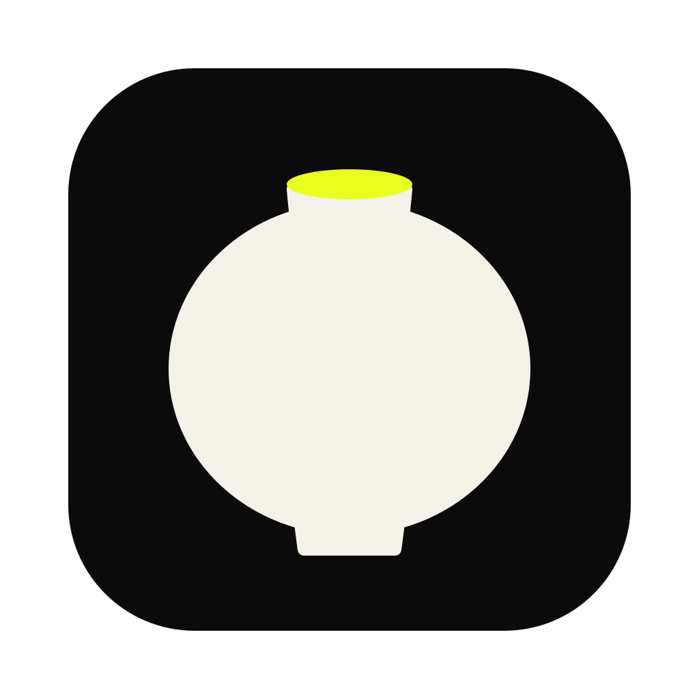
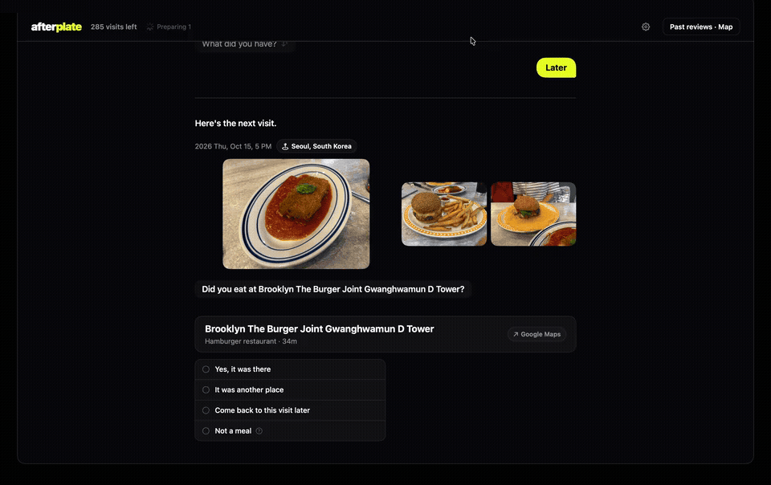
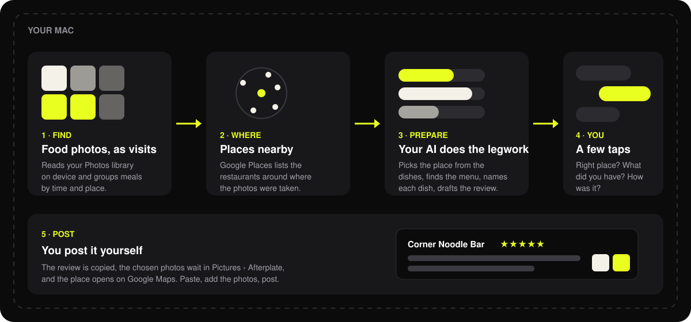
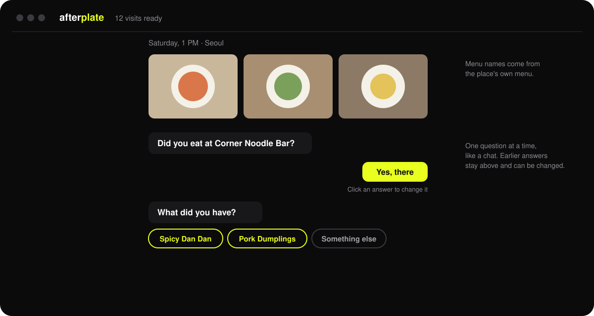
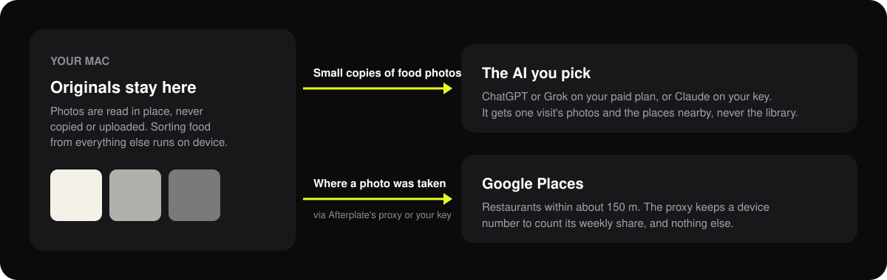

<p align="center"><b>English</b> · <a href="README.ko.md">한국어</a></p>

<p align="center"></p>

<h1 align="center">Afterplate</h1>

<p align="center">All those food photos, reviewed at last.<br>A Mac app that turns the meals in your Photos library into Google Maps reviews, a few taps each.</p>

<p align="center"></p>

---

## How it works



1. **Find.** The app reads your Photos library on the Mac. On-device models (Apple Vision and Google's SigLIP) pick out the meals. Photos taken close together in time and place become one visit.
2. **Where.** Google Places lists the restaurants within about 150 m of where the photos were taken.
3. **Prepare.** The AI you choose reads the photos and the list. It picks the place by what is on the table. It finds the place's real menu on the web, names each dish from that menu, and drafts a review. Several visits are prepared ahead, so they are ready when you get to them.
4. **You.** One question at a time, like a chat. Right place? What did you have? How was it? A guess is never shown as an answer. If the app isn't sure, it asks.
5. **Post.** You post it yourself. The review is copied, the photos you kept are waiting in `Pictures › Afterplate`, and the place opens on Google Maps.

## The conversation



- Drag a photo out of a visit to leave it out of the review. Click it to see it big.
- Click an earlier answer to change it.
- "Later" puts a visit off. "Not a meal" takes it out for good.

## What leaves your Mac



- **Originals** are never copied or uploaded.
- **Small copies of a visit's photos** go to the AI you picked, so it can see the dishes.
- **Where a photo was taken** goes to Google Places. By default this goes through Afterplate's proxy, a small server that holds Afterplate's Google key. It keeps a device number only to count that Mac's weekly share. With [your own Google Maps key](docs/google-maps-key.md), it goes straight to Google.

## Choosing the AI

| AI | You need | Cost |
|---|---|---|
| ChatGPT | ChatGPT Plus or higher | Your plan's allowance, no extra charge |
| Grok | SuperGrok or X Premium+ | Your plan's allowance, no extra charge |
| Claude | An API key from platform.claude.com | About $0.18 a visit. Preparing ahead stops at $1 per launch |

Free ChatGPT and Grok accounts don't work. You can change the AI any time in Settings.

## Place search

Every Mac gets a weekly share of Afterplate's Google searches: 25 searches, about 15 visits. It refills every Monday at 00:00 UTC. A visit takes one or two searches. When the share runs out, the visit says when it comes back and is looked up again by itself then.

To skip the share, add your own key in **Settings › Place search**. See [docs/google-maps-key.md](docs/google-maps-key.md) for how to get one. Google's free monthly calls cover about 2,500 visits.

## Install

Requires macOS 14 or later. Download the notarized app from [Releases](../../releases), unzip it, and move **Afterplate** to Applications.

### Build from source

Step by step, from a Mac with nothing installed, or with an AI agent doing it for you: [docs/build.md](docs/build.md).

```bash
brew install xcodegen
cd mac
./run.sh                 # Debug build, then launches it
./release.sh --notarize  # Developer ID build, notarized (needs your own identity and notary profile)
```

The photo model is not in the source. To build with it, run `mac/model/get-model.sh` once: it downloads [SigLIP](https://huggingface.co/google/siglip-base-patch16-224) from Hugging Face (about 800MB) and converts it to Core ML on your Mac. It needs [uv](https://docs.astral.sh/uv/) (`brew install uv`). Without it the app sorts photos with Apple Vision alone and misses some meals. The notarized app in Releases has the model inside.

Without a certificate the build is signed ad hoc and runs, but macOS asks for Photos access again after every rebuild. To keep it, put your development certificate in `mac/Signing.local.xcconfig`:

```
CODE_SIGN_IDENTITY = Apple Development: Your Name (TEAMID)
```

`release.sh` reads `IDENTITY`, `TEAM` and `PROFILE` (a `notarytool` keychain profile) from `mac/release.local`. Neither file is checked in.

A build from source uses Afterplate's place-search proxy like the released app. To go straight to Google instead, add your own key in **Settings › Place search**.

## Licenses

Afterplate is under the [MIT License](LICENSE). The on-device image model is [SigLIP](https://huggingface.co/google/siglip-base-patch16-224) (`google/siglip-base-patch16-224`, Apache 2.0), its image tower converted to Core ML by `mac/model/get-model.sh` and shipped inside the notarized app with its license (`SigLIPImage.LICENSE`).

## Layout

```
mac/        the app (SwiftUI, macOS 14+); project.yml for XcodeGen
mac/icon/   the app icon, as SVG
docs/       guides and the images on this page
```

## Open problem: what preparing a visit costs

On Claude, preparing one visit costs about $0.15–0.18. Most of that is the menu search: Sonnet with up to three web searches is about $0.13, mostly input tokens from search-result pages. Place matching adds about $0.03.

Measured on 8 places:

| Menu search | Dishes found (of 12) | Cost per visit |
|---|---|---|
| Sonnet, three searches | 9 | $0.127 |
| Sonnet, one search | 6 | $0.064 |
| Haiku 4.5 | Found a menu at 1 of 8 places | — |

Ideas not built yet:
- share found menus between users (needs a server);
- fewer place-match candidates;
- cheaper search-result pages.

If you find a better way, please open an issue.

## Status

Early beta. Built and used daily in Seoul. The app comes in Korean and English, and reviews are written in the app's language. A Korean review can also be shown in English on the last step.
